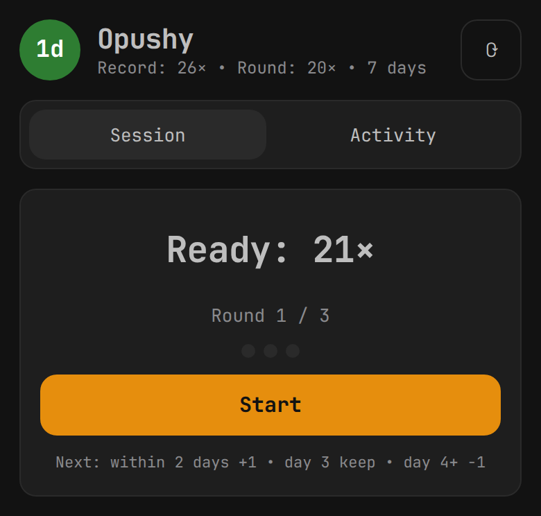
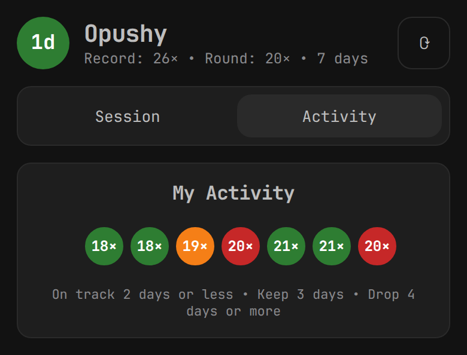

# opushy-hub

The always-on half of [Opushy](https://github.com/h1st0ry3D/opushy). It keeps one
SQLite database on the NAS, answers a small HTTP API, and serves a phone-sized
web app that runs the same three-round session as the Omarchy bar widget.

The plugin does not change. It keeps a local file, runs a local helper, and opens
no sockets. A bridge on the PC copies sessions between that file and the hub, so
a sleeping NAS cannot freeze the desktop bar.

## The app

Both screens at a 390 px viewport, in the theme's own palette.

| Session | Activity |
| --- | --- |
|  |  |

## Why a hub

The plugin's document carries `maxPushups`, `reps`, `lastTrainingDate`,
`trainingDays` and `history`. Only `maxPushups` is a fact. The other four follow
from the sessions, and two devices that derive them separately end up disagreeing
about the day count.

The hub stores sessions and nothing else.

```sql
sessions(id TEXT PRIMARY KEY, time TEXT NOT NULL, reps INTEGER NOT NULL, device TEXT)
meta(key TEXT PRIMARY KEY, value TEXT NOT NULL)   -- maxPushups, rev
```

`id` is `sha256("time|reps")`, so the same session offered by two devices becomes
one row. Sync is an idempotent upsert. Nothing copies a whole file, so one device
cannot overwrite another.

The hub does not reimplement the training rules. `src/rules.ts` evaluates the
plugin's own `core/Progression.js` inside a `vm` context. A test fails when the
vendored copy differs from the plugin's copy.

## HTTP API

Send `Authorization: Bearer <token>` on every route except `/api/health`.

| Route | What it does |
| --- | --- |
| `GET /api/health` | reports the session count, open to the container healthcheck |
| `GET /api/state` | derived state plus every session with its status colour |
| `POST /api/sessions` | takes `{device, sessions: [{time, reps}]}` and upserts |
| `PUT /api/max` | sets the record on first run and never lowers it |
| `GET /api/export` | returns the plugin's own document shape |

`GET /api/state` also returns `rev`, a counter that rises on every write. A
bridge compares that one number instead of diffing JSON.

## Run it

```sh
mise install
mise run dev          # http://localhost:8080
```

The first boot writes `data/token` with mode 0600. The web app asks for that
token once and keeps it in `localStorage`.

To load the history that already sits in the desktop file:

```sh
bun scripts/seed.ts ~/.local/state/opushy/opushy_activity.json
```

The upsert makes this safe to repeat, and a second run adds nothing.

```sh
mise run test         # bun test
mise run check        # tsc --noEmit && biome check
mise run fix          # biome check --write
```

On the NAS, follow [docs/nas.md](docs/nas.md). DSM ships no git, so that page
builds from an unpacked tarball instead of a git context, and it covers the
update and rollback steps.

## Theme

The dark palette is the matte-black theme's, taken from
`/usr/share/omarchy/themes/matte-black/colors.toml`. Background is `#121212`,
cards are `#1e1e1e`, buttons are `#2a2a2a`, text is `#bebebe` and the accent is
`#e68e0d`.

The three status colours do not come from the theme. They come from the plugin's
`ui/Status.js`, so the discs here match the discs in the bar. The light palette is
still in `web/tokens.css` behind `data-theme="light"`, and nothing switches to it
on its own.

## Stack

Bun 1.4, Hono 4.13, Zod 4, `bun:sqlite`, Preact 11, Biome 2.5 and TypeScript 7.
That is three runtime dependencies and three for development.

There is no build command. `src/server.ts` imports `web/index.html` with
`{ type: "html" }`, and Bun bundles the `.tsx` files behind it when a page is
requested. `bun --watch` restarts the server, and no `dist/` directory exists to
go stale.

`compose.yaml` in the repo root builds straight from a checkout. The NAS uses its
own file, because the path there is a downloaded tarball. See [docs/nas.md](docs/nas.md).

## What this is not

The hub speaks plain HTTP, so there is no service worker and the web app is not an
installable offline page. It works on the home network and needs the hub awake.

Plain HTTP also means the token crosses the wire in clear text. That is fine for
one household and not fine for a network with devices you do not trust. Adding TLS
later means a reverse proxy in front of the container, and nothing in the app has
to change.

## Next

The bridge on the PC is not written yet. It will push the local sessions to
`POST /api/sessions`, then feed `GET /api/export` into
`opushy-state.py state merge`.

The plugin side is ready. `state merge` holds an exclusive `flock` for the whole
read-modify-write, so a bridge and the panel cannot both decide what the file
says.

## Licence

MIT. See [LICENSE](LICENSE).
